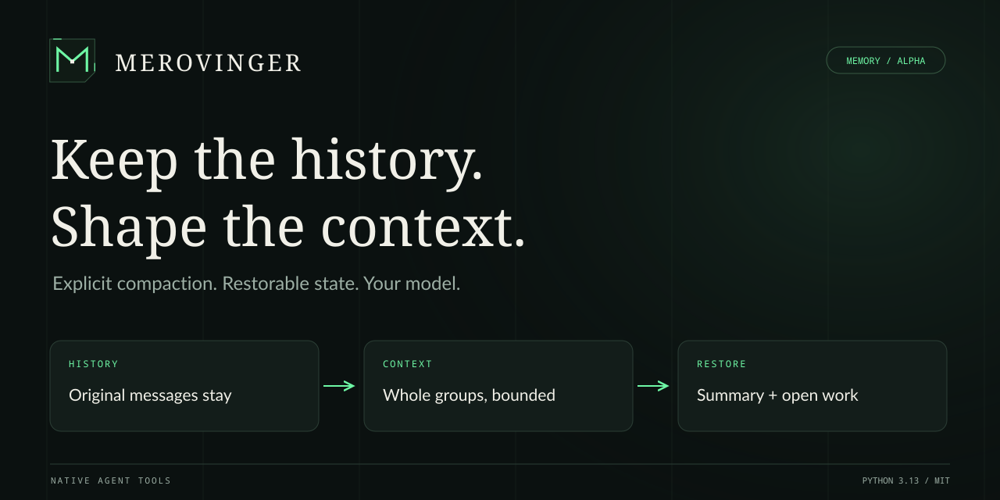
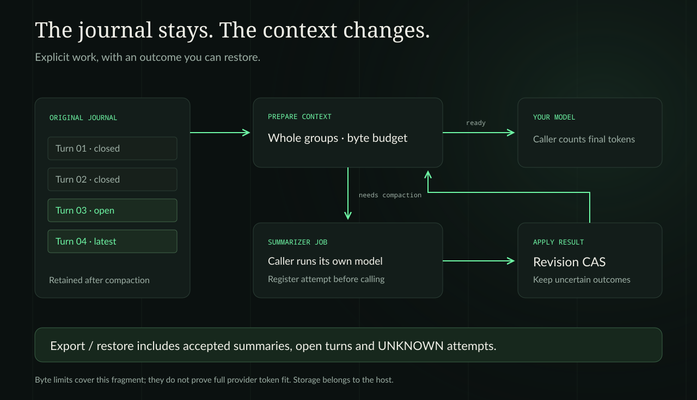
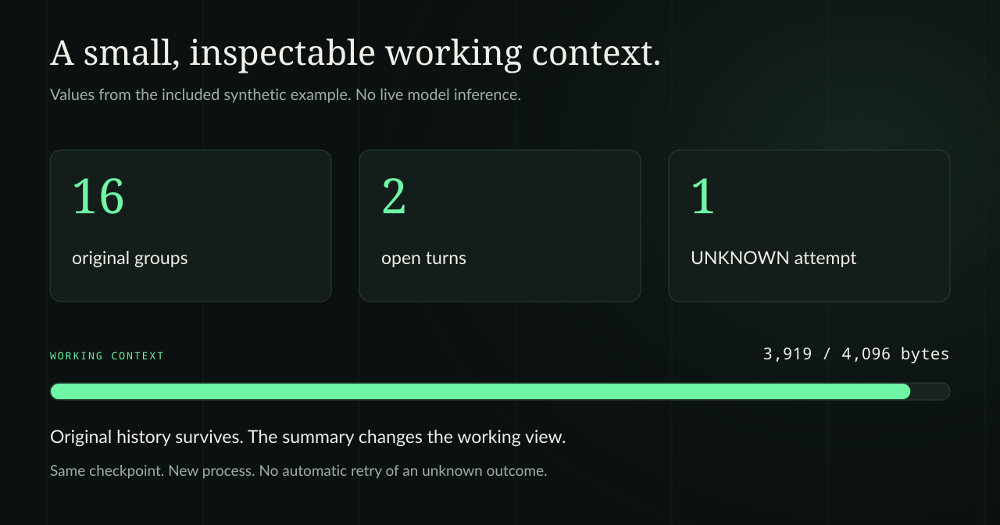

**English** · [Русский](README.ru.md)



# Merovinger Memory

**Bounded conversation history. Explicit compaction. Restorable uncertainty.**

A small Python library for applications that own their chat history and choose when to summarize it. Keep complete bounded source history, prepare a smaller working context, and apply a caller-provided summary only against the expected revision.

**Alpha · Python 3.13 · MIT · zero runtime dependencies**

[Quickstart](docs/quickstart.md) · [Architecture](docs/architecture.md) · [Limits](docs/limits.md) · [Verification](docs/verification.md)

## Install

Install from this repository; no PyPI release is advertised:

```sh
python -m pip install "git+https://github.com/k4raga/merovinger-memory.git"
```

Or clone it and run `python -m pip install .` with Python 3.13.

The distribution is **`merovinger-memory`**. The import namespace **`agent_native_memory`** is retained for API compatibility. Do not co-install distributions that own that same namespace.

## Use it

```python
import json
from agent_native_memory import ConversationMemory

memory = ConversationMemory(project_id="my-app", conversation_id="chat-1")
turn = memory.begin_turn("Remember: the release is on Friday.", event_id="user-1")
memory.reply(turn, "Friday noted.", event_id="assistant-1")
memory.close_turn(turn)  # A reply alone does not close a group.
memory.begin_turn("What should I prepare?", event_id="user-2")

context = memory.prepare(byte_limit=4096, allow_compaction=False)
assert context.status == "ready"
print(json.loads(context.context))

checkpoint = memory.export_state()  # Bytes; your application handles file IO.
restored = ConversationMemory.from_state(checkpoint)
assert restored.export_state() == checkpoint
```

`ready` means this serialized context fits the **byte** limit. It does not guarantee that a complete model request fits a provider's token window.

## How it works



1. Append text exchanges with stable event IDs. Open groups remain protected.
2. Prepare whole groups within a byte budget. Required content is never silently truncated.
3. If compaction is requested, register the attempt **before** calling your summarizer.
4. Apply the result with a revision check. Concurrent changes can make it stale.
5. Export and restore history, accepted summary and the attempt ledger, including `UNKNOWN`.

Compaction preserves the original bounded history. It does not create unlimited storage. If mandatory content cannot fit, the result is `cannot_fit`.



The library makes no model calls. Your application chooses the summarizer and owns serialization, persistence and any provider integration. An unresolved attempt is retained; it does not trigger a background retry.

## Run the example

[The checkpoint example](examples/checkpoint.py) uses a fixed caller summary, writes a versioned checkpoint, and verifies restoration in a second process. It needs no model, UI or account:

```sh
python -I -B examples/checkpoint.py --smoke --report /absolute/create.json --checkpoint /absolute/chat.json
python -I -B examples/checkpoint.py --restore-smoke --report /absolute/restore.json --checkpoint /absolute/chat.json
```

Use absolute output paths on your OS; see [Windows commands](docs/quickstart.md#checkpoint-example). Reports say `PASS` or `FAIL` and the process returns a matching exit code.

## Scope

Included: text groups, bounded context selection, explicit summary lifecycle, in-process revision CAS, versioned export/restore, and a lower-level token-evidence planner.

Excluded: RAG, embeddings, a tokenizer, provider adapters, background inference, a database, durable exactly-once execution and arbitrary parallel tool-call protocols. Summaries are untrusted data, not instructions or authorization.

The API and checkpoint format are alpha. See [limits](docs/limits.md) before integration and [verification](docs/verification.md) for what the checks establish.

[Contributing](CONTRIBUTING.md) · [Changelog](CHANGELOG.md) · [MIT license](LICENSE)
