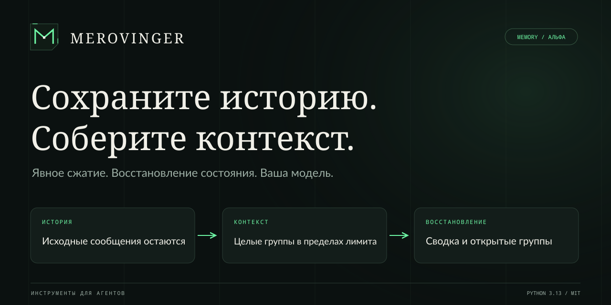
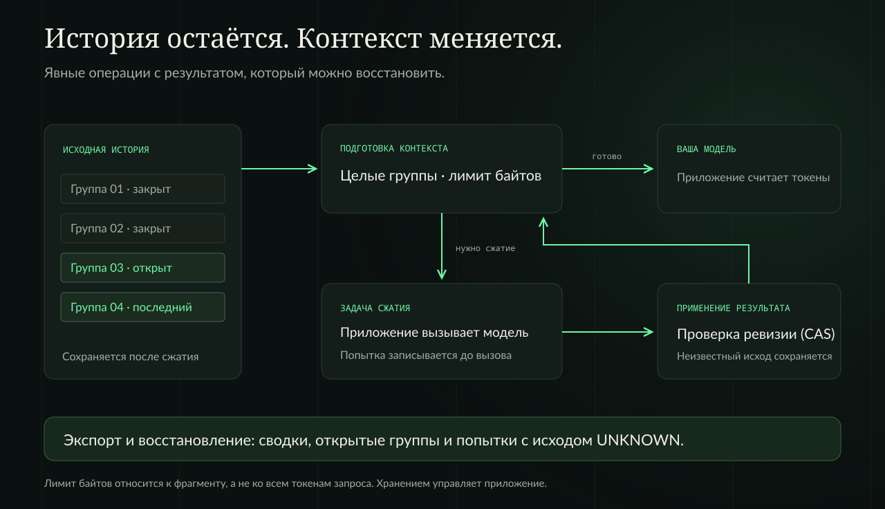
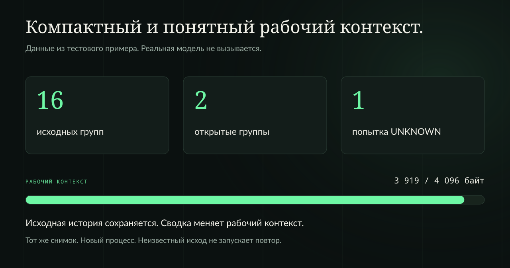

[English](README.md) · **Русский**



# Merovinger Memory

**Ограниченная история диалога. Явное сжатие. Восстановление неизвестного исхода.**

Небольшая Python-библиотека для приложения, которое само хранит историю чата и решает, когда её сжать. Полная исходная история сохраняется в заданных пределах; рабочий контекст можно уменьшить, а результат внешнего summarizer применяется только при совпадении ожидаемой ревизии.

**Альфа · Python 3.13 · MIT · без runtime-зависимостей**

[Быстрый старт](docs/quickstart.ru.md) · [Архитектура](docs/architecture.ru.md) · [Ограничения](docs/limits.ru.md) · [Проверки](docs/verification.ru.md)

## Установка

Установка из репозитория; публикация на PyPI не заявлена:

```sh
python -m pip install "git+https://github.com/k4raga/merovinger-memory.git"
```

Либо клонируйте репозиторий и выполните `python -m pip install .` в Python 3.13.

Имя distribution — **`merovinger-memory`**, namespace импорта — **`agent_native_memory`**. Он сохранён для совместимости API. Не устанавливайте одновременно разные distributions, владеющие этим namespace.

## Подключение

```python
import json
from agent_native_memory import ConversationMemory

memory = ConversationMemory(project_id="my-app", conversation_id="chat-1")
turn = memory.begin_turn("Релиз запланирован на пятницу.", event_id="user-1")
memory.reply(turn, "Запомнил: пятница.", event_id="assistant-1")
memory.close_turn(turn)  # Ответ сам по себе не закрывает группу.
memory.begin_turn("Что подготовить?", event_id="user-2")

context = memory.prepare(byte_limit=4096, allow_compaction=False)
assert context.status == "ready"
print(json.loads(context.context))

checkpoint = memory.export_state()  # Запись файла выполняет ваше приложение.
restored = ConversationMemory.from_state(checkpoint)
assert restored.export_state() == checkpoint
```

`ready` означает, что сериализованный контекст укладывается в **байтовый** лимит. Это не гарантия, что весь запрос к модели помещается в её окно токенов.

## Механика



1. Добавляйте текстовые обмены со стабильными ID. Открытые группы защищены.
2. Подготавливайте контекст из целых групп. Обязательные данные не обрезаются молча.
3. При необходимости сжатия зарегистрируйте попытку **до** вызова своего summarizer.
4. Примените результат с проверкой ревизии. Параллельные изменения могут сделать его устаревшим.
5. Экспортируйте и восстановите историю, принятую summary и журнал попыток, включая `UNKNOWN`.

Сжатие не удаляет исходную историю и не создаёт бесконечное хранилище. Если обязательные данные не помещаются, возвращается `cannot_fit`.



Библиотека не вызывает модель. Summarizer, сериализация, persistence и подключение провайдера остаются у приложения. Неизвестный исход сохраняется и не запускает фоновый повтор.

## Пример

[Пример checkpoint](examples/checkpoint.py) использует заранее заданную строку summary, сохраняет состояние и проверяет его во втором процессе. Модель, UI и аккаунты не нужны:

```sh
python -I -B examples/checkpoint.py --smoke --report /absolute/create.json --checkpoint /absolute/chat.json
python -I -B examples/checkpoint.py --restore-smoke --report /absolute/restore.json --checkpoint /absolute/chat.json
```

Пути вывода должны быть абсолютными для вашей ОС; [команды Windows](docs/quickstart.ru.md#пример-сохранения). Результат записывается как `PASS`/`FAIL`, код завершения соответствует ему.

## Границы

Есть текстовые группы, ограниченный контекст, явный жизненный цикл summary, in-process revision CAS, versioned export/restore и низкоуровневый planner с token evidence.

Нет RAG, embeddings, tokenizer, provider adapters, фонового inference, собственной БД, durable exactly-once и универсальной поддержки параллельных tool calls. Summary — недоверенные данные, а не инструкции или разрешение на действие.

API и формат checkpoint находятся в альфе. [Ограничения](docs/limits.ru.md) и [проверки](docs/verification.ru.md) описывают точные границы.

[Участие в разработке](CONTRIBUTING.ru.md) · [Изменения](CHANGELOG.ru.md) · [Лицензия MIT](LICENSE)
