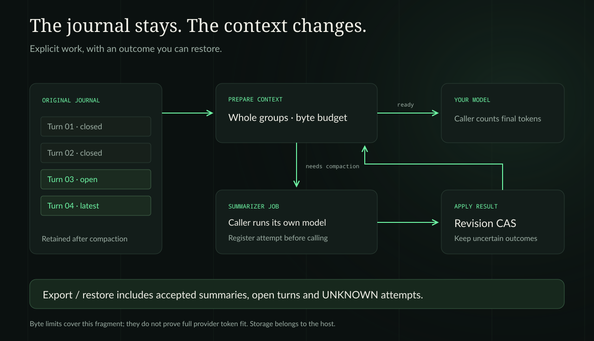

**English** · [Русский](architecture.ru.md)

# Architecture

`ConversationMemory` is a bounded in-memory owner for text exchanges. Stable caller event IDs make identical appends idempotent; reusing an ID for different content fails. Replies do not implicitly close groups.

The immutable snapshot separates full retained history from its working window and accepted summary. `prepare()` selects whole groups and preserves open groups and the latest intent. It returns measured serialized bytes and status data; it does not send anything to a provider.

Compaction is explicit:

- `begin_compaction(prepared)` validates current input and records an inflight attempt.
- The caller performs external work or supplies a string directly.
- `complete_compaction(..., expected_revision=...)` checks applicability and publishes summary plus attempt outcome under an in-process lock and revision comparison.
- `mark_unknown()` retains an unresolved outcome. No automatic retry occurs.

Export/restore covers history, summary, coverage, revision and attempt records. The caller owns file/database IO. This local CAS is not a transaction across a provider and persistent storage.

The lower-level immutable values/window/planner API remains available for integrations with their own history source and complete-request counting. The convenience owner does not create export authority: source digests are lineage commitments, and summary text remains untrusted.

The implementation has no dependency on UI, an agent runner, model accounts, a tokenizer or a database. See [limits](limits.md) for boundaries.
