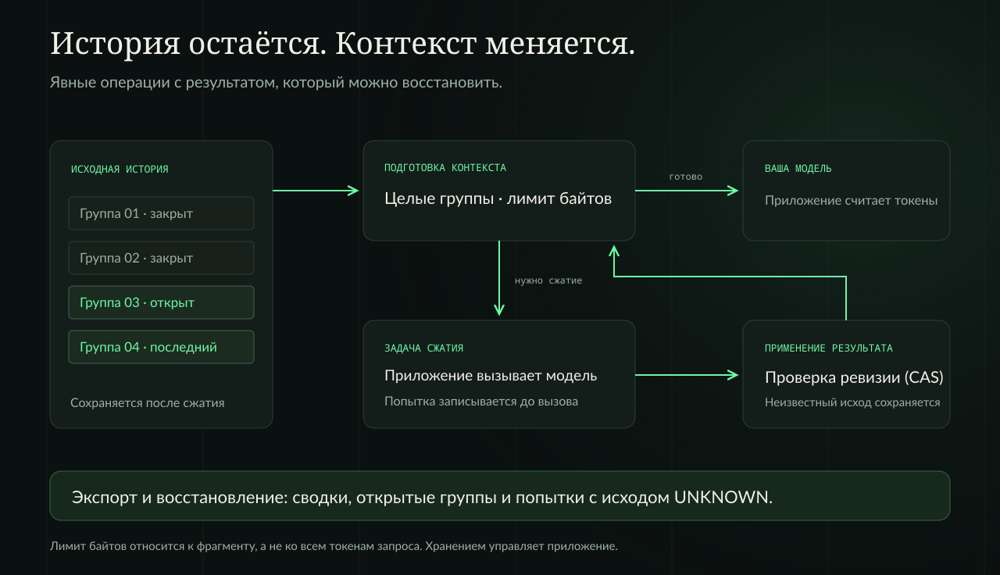

[English](architecture.md) · **Русский**

# Архитектура

`ConversationMemory` владеет ограниченной историей текстовых обменов в памяти
процесса. Стабильные ID событий от приложения делают одинаковое добавление
идемпотентным; повторное использование ID для другого содержимого отклоняется.
Ответ сам по себе не закрывает группу.

Неизменяемый снимок разделяет полную сохранённую историю, рабочее окно
и принятую сводку. `prepare()` выбирает целые группы, сохраняет открытые группы
и последнее намерение пользователя. Возвращаются измеренные байты сериализации
и статус; провайдеру ничего не отправляется.

Сжатие выполняется явно:

- `begin_compaction(prepared)` проверяет текущий вход и записывает выполняемую попытку.
- Приложение выполняет внешнюю работу или передаёт готовую строку напрямую.
- `complete_compaction(..., expected_revision=...)` проверяет применимость
  и публикует сводку вместе с исходом попытки под блокировкой процесса
  с проверкой ревизии.
- `mark_unknown()` сохраняет неизвестный исход. Автоматического повтора нет.

Экспорт и восстановление включают историю, сводку, покрытие, ревизию
и записи попыток. Запись файлов и базы данных принадлежит приложению.
Этот локальный CAS не является транзакцией между провайдером и постоянным
хранилищем.

Низкоуровневый API неизменяемых значений, окна и планировщика доступен интеграциям
со своим источником истории и подсчётом полного запроса.
Удобный фасад не создаёт прав на экспорт: хеши фиксируют происхождение данных,
а текст сводки остаётся недоверенным.

Реализация не зависит от UI, раннера агента, учётной записи модели,
токенизатора или базы данных. Границы описаны в [ограничениях](limits.ru.md).
